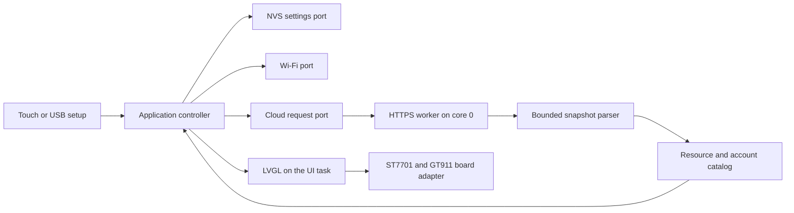

# Architecture and verification

## Data flow

Domain types have no Arduino or LVGL dependency. The controller owns connection verification, four stable selections, persistence and request generations. An older in-flight reply cannot restore a previous account after a configuration change. JSON and hardware libraries remain outside the application boundary.

The worker passes owned results through a one-entry queue. It never calls LVGL. The UI task applies complete snapshots and updates changed labels/bars. A picker retains its position while background readings change; explicit refresh rebuilds its list. Settings input is not rebuilt by polling.

## Memory and timing

The board has 8 MB PSRAM. Two complete RGB565 framebuffers use PSRAM (900 KiB total). LVGL draws changed areas into the back buffer and swaps it only after rendering. The RGB completion interrupt gates reuse of the previous front buffer; LVGL then synchronizes changed areas between them. Two internal 10-line bounce buffers feed scanout. The 2 MB Unicode font is embedded in flash. ESP-IDF copies instructions and read-only data, including that font, into PSRAM at boot so flash writes do not stall external memory access. Small bounded glyph caches render Korean/Latin names on demand. Drivers are initialized before application allocation is directed to PSRAM, preserving internal memory for capability-specific DMA, stacks and Wi-Fi allocations.

HTTP bodies and JSON allocations have separate limits. A single request is active at a time. Wi-Fi association and scanning progress asynchronously. HTTPS runs outside the UI task; the UI loop yields every 5 ms. Flash writes occur for verified connection changes and changed selections, not periodic readings.

The upload bundle writes boot metadata at `0xe000`. The partition table reserves that range outside the `0x9000`–`0xe000` NVS region. Uploading individual images preserves settings. The single application slot does not provide an OTA update service.

## Verification commands

Run `build/venv/bin/python tools/check.py` after the pinned setup. It runs address/undefined-behavior sanitizers, then renders the actual LVGL screens and exercises pointer events. Tests cover:

- Credential and HTTPS-origin validation, Unicode, timestamps and malformed JSON.
- Custom metric order, missing values, multiple accounts and stale reports.
- Verified saves, rejected keys, delayed replies, account changes, offline retention and timer rollover.
- Four touch cards, category selection, setup forms, actual keyboard input and masking.
- The idle redraw budget: unchanged readings do not repaint the dashboard.
- USB readiness after CH340 reset, response correlation, one-shot setting changes, frame splitting and size limits.

`tools/build_firmware.py` builds the pinned ESP-IDF SDK and Arduino component from source. It enforces a 64 KB data cache with 64-byte lines, conditional DMA recovery, PSRAM instruction/read-only-data placement and cache-safe RGB interrupts. It compiles the exact target, checks the 8 MB application limit and records artifact hashes. `tools/flash_firmware.py` verifies hashes and upload ranges before writing. Native tests and cross-compilation do not substitute for the [physical device checks](hardware.md#device-acceptance-checks).
