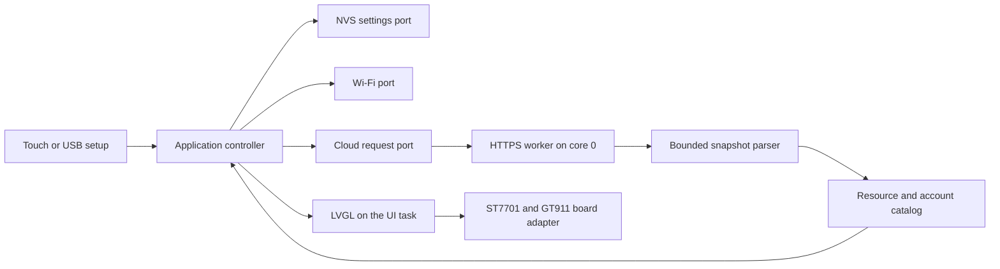

# Architecture and verification

## Data flow

Domain types have no Arduino or LVGL dependency. The controller owns connection verification, four stable selections, persistence and request generations. An older in-flight reply cannot restore a previous account after a configuration change. JSON and hardware libraries remain outside the application boundary.

`app-contract.json` pins public App policy, timing constants and behavioral fixtures by commit and SHA-256. `tools/generate_contract.py` verifies those bytes and emits a C++ state table and the measurement tone bounds in `build/generated`. The JSON adapter retains bounded per-project state and sorts it before the domain aggregates account status. Both App and ESP32 run the same contract cases, including exact freshness boundaries, offline aging, attention priority, account isolation, plan usage reset countdowns and plan usage tones. Web consumes the same App snapshot.

To update the contract, run `python tools/sync_contract.py --revision FULL_APP_COMMIT`. Add `--app-dir ../vibemon-app` to read that exact commit locally. Never edit files in `contracts/`; change their App source and sync. Native and firmware builds verify the pinned snapshot without requiring App or Web access.

The controller also owns conditional polling. It stores the displayed catalog's `ETag`, `serverTime` and request key, and passes the tag in the next request only for the same key. The worker sends `If-None-Match`, collects `ETag`, `X-Server-Time` and `Retry-After`, and passes a 304 back as a "not modified" result; `src/adapters/cloud_http` validates those header values. The worker passes owned results through a one-entry queue. It never calls LVGL. The UI task applies complete snapshots and updates changed labels/bars. A picker retains its position while background readings change; explicit refresh rebuilds its list only after an accepted full response. Failures keep the old list and show the reason while waiting for recovery. Opening a picker after empty panels paused polling also requests that refresh. Settings input is not rebuilt by polling.

Touch uses the dark variant of App's pinned product palette. `tools/generate_contract.py` produces the C++ colors directly from `contracts/tokens.css`; native tests check text contrast after RGB565 quantization. Populated cards open scrollable details with all metrics and reporting projects. Long names and units wrap, while updates reuse the existing rows and preserve scroll position. **Change item** opens the panel selector; empty cards open it directly.

## Memory and timing

The board has 8 MB PSRAM. Two complete RGB565 framebuffers use PSRAM (900 KiB total). LVGL draws changed areas into the back buffer and swaps it only after rendering. The RGB completion interrupt gates reuse of the previous front buffer; LVGL then synchronizes changed areas between them. Two internal 10-line bounce buffers feed scanout. The 2 MB Unicode font is embedded in flash. ESP-IDF copies instructions and read-only data, including that font, into PSRAM at boot so flash writes do not stall external memory access. Small bounded glyph caches render Korean/Latin names on demand. Drivers are initialized before application allocation is directed to PSRAM, preserving internal memory for capability-specific DMA, stacks and Wi-Fi allocations.

HTTP bodies and JSON allocations have separate limits. A single request is active at a time. The HTTPS worker keeps its TLS connection between polls with HTTP keep-alive, so a poll normally skips the full handshake. It closes the connection after a failure, an origin change or 15 seconds without a request; this frees the session's internal-RAM buffers. If the server closed a kept connection, the worker retries once on a new one. Each TLS session holds at least 32 KiB of internal RAM for its two 16 KiB record buffers. A release check or the first 15 seconds of an install can run while the workspace session is open, so two sessions can coexist; polling pauses during an install, which then closes the workspace session. Cloud and release metadata use the same bounded response stream, including chunked responses without `Content-Length`. PSRAM buffers grow up to 1 MiB for a workspace and 2 KiB for `ota.json`; oversized input is rejected before allocation. Body writes stop after 15 seconds. Wi-Fi association and scanning progress asynchronously. HTTPS runs outside the UI task; the UI loop yields every 5 ms. Flash writes occur for verified connection changes and changed selections, not periodic readings.

Coding cards animate small light trails around their rounded edges at up to 30 updates per second. Working, thinking, planning and compacting have different colors and rhythms; input requests pulse, errors use two fast trails, and completion makes one green sweep. Standby cards stop animating. Only the lights' previous and next regions are invalidated; text and card geometry remain fixed. Leaving the dashboard destroys the lights and stops their updates. Dynamic category labels use the same Unicode font fallback as other readings, including the account separator.

Measurements retain binary64 precision throughout JSON parsing. `tools/prepare_json.py` applies a hash-verified change to the isolated ArduinoJson numeric parser: decimal tokens use C++ `from_chars` rather than narrowing short mantissas to 32-bit floats. This preserves the Web value before formatting; for example, `1.005` remains the same double and displays as `1.01%`. The original and modified parser hashes are locked. User-installed libraries and the ESP-IDF checkout remain untouched.

The upload bundle writes boot metadata at `0xe000`. The partition table reserves that range outside the `0x9000`–`0xe000` NVS region. Uploading individual images preserves settings. Two 7 MB application slots (`app0`, `app1`) hold the running image and the next update. The bootloader rolls back an update that restarts before it confirms itself; see [Firmware updates](#firmware-updates).

## Firmware updates

The device installs new releases over Wi-Fi. Two 7 MB application slots hold the running image and the next one.

1. **Check.** 30 seconds after Wi-Fi and network time are ready, then every 6 hours, the device reads `ota.json` from `https://github.com/opspresso/vibemon-esp32/releases/latest/download/`. A tap on the firmware row in device settings, or the USB `update-check` command, checks immediately. A failed check retries after 15 minutes.
2. **Accept.** The device accepts the release only when the board is `ESP32-4848S040`, the version is a newer `MAJOR.MINOR.PATCH`, the image fits one slot and the URL is in this repository's releases. Prereleases are never "latest", so they are not installed.
3. **Install.** The update worker on core 0 streams the image into the slot that is not running. Workspace polling pauses until the restart. The dashboard status line shows the version and progress.
4. **Verify.** The next boot selects the new slot only when the SHA-256 digest from `ota.json` matches and ESP-IDF validates the image. Otherwise the running image stays selected, and the device retries at the next 6-hour check.
5. **Confirm or roll back.** The new image starts on trial. It confirms itself when it reaches the workspace or the release server and the SDK stores the confirmation. If that write fails, device settings show **Confirm failed · tap to retry** and another firmware check retries it. Further installs wait for confirmation. The UI loop never repeatedly writes the failed confirmation. If the device restarts before confirmation, the bootloader starts the previous image again.

TLS to GitHub authenticates the release files; the firmware images are not signed. The partition table and bootloader do not change over Wi-Fi. A change to either needs a USB upload.

## Verification commands

Run `build/venv/bin/python tools/check.py` after the pinned setup. It runs address/undefined-behavior sanitizers, then renders the actual LVGL screens and exercises pointer events. Tests cover:

- Credential and HTTPS-origin validation, Unicode, timestamps and malformed JSON.
- Custom metric order, missing values, multiple accounts and standby reports.
- Verified saves, rejected keys, delayed replies, account changes, offline retention and timer rollover.
- Conditional polling: 304 reuse and clock re-anchoring, query and generation changes, and 304 replies without a cached reply or `X-Server-Time`.
- Four touch cards, category selection, setup forms, actual keyboard input and masking.
- Long Korean names, 32 metrics, complete values and units, touch scrolling, per-project states and scroll retention during a reading update.
- Bounded animation redraw regions, stable touch targets, Unicode category separators, and zero idle redraws after activity stops.
- USB readiness after CH340 reset, response correlation, one-shot setting changes, frame splitting and size limits.

`tools/build_firmware.py` builds the pinned ESP-IDF SDK and Arduino component from source. It enforces a 64 KB data cache with 64-byte lines, conditional DMA recovery, PSRAM instruction/read-only-data placement and cache-safe RGB interrupts. It compiles the exact target, checks the 7 MB application-slot limit and records artifact hashes. `tools/flash_firmware.py` verifies hashes and upload ranges before writing. Native tests and cross-compilation do not substitute for the [physical device checks](hardware.md#device-acceptance-checks).

## Distribution notices

Firmware artifacts include `licenses/index.json` and the files it hashes. `tools/collect_licenses.py` collects notices from the pinned libraries, configured ESP-IDF components and compiler runtimes, plus leading copyright/license comments from compiled source files. Component distributions may contain optional code eliminated during linking; the index identifies the source package rather than claiming that every component remains in the binary.

The bundle explicitly includes Nanum Gothic, the Montserrat and Font Awesome 5 fonts used by LVGL, App artwork/policy licensing, and the SDK's public CA source bundle with its [MPL 2.0 license](https://www.mozilla.org/en-US/MPL/2.0/). The CA source and its conversion licensing are described by [curl's CA extraction project](https://curl.se/docs/caextract.html). Notice collection does not change certificate trust. The firmware manifest records the notice index hash, and CI uploads the whole notice directory. Unrelated files and symlink escapes in that generated directory stop regeneration instead of being overwritten.
